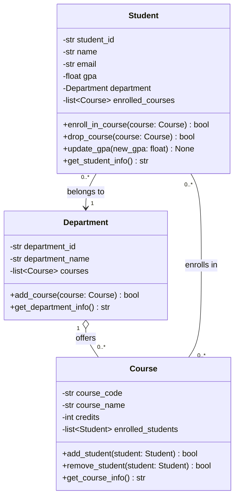

# Student Class Diagram

A simple object-oriented Python project implementing a UML Student Class Diagram with three classes: `Department`, `Course`, and `Student`.

**Author:** Eray Okuslug (20231882) — Near East University, Department of Computer Engineering

## Project Structure

- `department.py` – `Department` class
- `course.py` – `Course` class
- `student.py` – `Student` class
- `main.py` – Example usage script

## UML Class Diagram



## How to Run

```bash
python main.py
```
